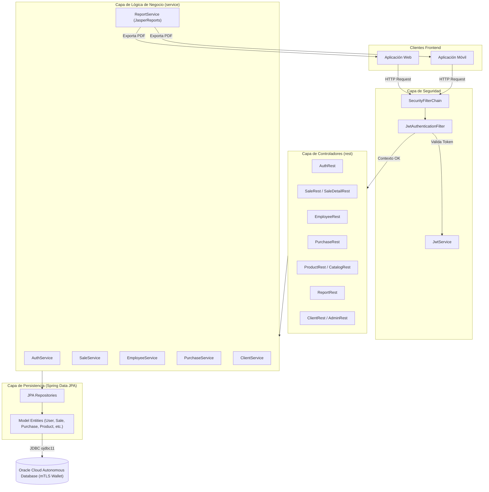

# Importaciones D&G - Backend API

API RESTful empresarial desarrollada con **Spring Boot 3** y **Java 17** para la gestión centralizada de compras internacionales, inventario, facturación/ventas, administración de personal y generación automatizada de reportes comerciales en PDF. Constituye el núcleo de servicios backend del ecosistema multiplataforma de Importaciones D&G (integrado con clientes Web y Móvil), implementando seguridad basada en JWT con control de acceso por roles (RBAC) y persistencia sobre Oracle Cloud Autonomous Database.


---

## 1. Funcionalidades Principales

- **Gestión de Seguridad & RBAC**: Autenticación stateless mediante tokens JWT, renovación con Refresh Tokens, cifrado de credenciales con BCrypt y autorización granular para tres niveles de usuario (`CLIENTE`, `VENDEDOR`, `ADMINISTRADOR`).
- **Módulo de Ventas y Facturación**: Emisión de órdenes de venta, validación de inventario en tiempo real, desglose de detalles de venta y cálculo automático de importes.
- **Gestión Integral de Empleados**: Registro, asignación de roles, validaciones de identidad, actualizaciones parciales y soporte de borrado lógico (*soft delete*) y reactivación.
- **Módulo de Compras e Importaciones**: Registro, control de proveedores y seguimiento de pedidos de importación con detalle por producto y actualización de stock.
- **Catálogo e Inventario Multisede**: Mantenimiento de productos, marcas, categorías y stock distribuido por sucursales u oficinas comerciales.
- **Generación de Reportes Financieros en PDF**: Motor de reportes dinámicos integrado con **JasperReports 7** para comprobantes de venta, inventarios y resúmenes ejecutivos.
- **Soporte Ecosistema Multiplataforma**: Contratos de API estandarizados bajo OpenAPI 3 para consumo simultáneo desde aplicación Web y aplicación Móvil.

---

## 2. Stack Tecnológico

| Tecnología | Rol en el Proyecto |
| :--- | :--- |
| **Java 17** | Lenguaje de desarrollo backend con soporte para características modernas de lenguaje. |
| **Spring Boot 3.4.4** | Framework principal para configuración automática, inyección de dependencias y servidor web embebido. |
| **Spring Security 6** | Framework de seguridad para filtrado de peticiones, contexto de autenticación y protección de endpoints. |
| **JJWT (io.jsonwebtoken 0.11.5)** | Generación, firmado y validación criptográfica de tokens JWT. |
| **Spring Data JPA / Hibernate** | Mapeo objeto-relacional (ORM) y abstracción de repositorios de persistencia. |
| **Oracle Database (ojdbc11)** | Motor de base de datos relacional cloud conectado mediante Oracle Wallet mTLS. |
| **JasperReports 7.0.1** | Motor compilador y exportador de plantillas JRXML para generación de reportes en PDF. |
| **Springdoc OpenAPI (Swagger 3)** | Generación automática de especificación OpenAPI y consola interactiva Swagger UI. |
| **Docker** | Contenedorización multietapa basada en imágenes ligeras `eclipse-temurin:17-jre-jammy`. |
| **Spring Boot Actuator** | Monitoreo y métricas de salud de la aplicación en producción. |

---

## 3. Arquitectura del Sistema

La solución implementa una **Arquitectura en Capas (Layered / N-Tier Architecture)** con separación estricta de responsabilidades y desacoplamiento mediante DTOs:

- **Capa de Filtros y Seguridad (`config`)**: Intercepta cada solicitud mediante `JwtAuthenticationFilter` (`OncePerRequestFilter`), validando el encabezado `Authorization: Bearer <token>` y cargando el contexto de seguridad en `SecurityContextHolder`.
- **Capa de Controladores REST (`rest`)**: Expone 76 endpoints RESTful, gestiona códigos de estado HTTP y documenta contratos mediante anotaciones Swagger/OpenAPI.
- **Capa de Servicios (`service`)**: Encapsula las reglas de negocio, transacciones ACID y orquestación con JasperReports.
- **Capa de Acceso a Datos (`repository`)**: Repositorios Spring Data JPA que ejecutan consultas nativas y JPQL sobre Oracle Database.
- **Capa de Dominio y DTOs (`model` / `dto`)**: Entidades JPA mapeadas y objetos de transferencia para aislar la persistencia del contrato público.



---

## 4. Estructura del Proyecto

```text
importaciones-dg-backend/
├── src/
│   ├── main/
│   │   ├── java/pe/edu/vallegrande/importaciones_backend/
│   │   │   ├── config/            # Seguridad, filtros JWT, configuración JasperReports
│   │   │   ├── dto/               # Data Transfer Objects para requests y responses
│   │   │   ├── enums/             # Constantes y enumeradores del dominio
│   │   │   ├── model/             # Entidades JPA (User, Sale, Purchase, Product, etc.)
│   │   │   ├── repository/        # Repositorios Spring Data JPA
│   │   │   ├── rest/              # Controladores REST organizados por módulo
│   │   │   ├── service/           # Servicios con lógica de negocio y transacciones
│   │   │   └── ImportacionesBackendApplication.java
│   │   └── resources/
│   │       ├── reports/           # Plantillas de diseño JRXML para reportes
│   │       ├── application.yml    # Configuración de datasource, JWT y perfiles
│   │       └── fontMappings.properties
│   └── test/
│       └── java/                  # Tests unitarios y de integración
├── Dockerfile                     # Construcción multietapa (builder + JRE runtime)
├── pom.xml                        # Dependencias de Maven y plugins de compilación
├── mvnw / mvnw.cmd                # Maven Wrapper
├── API_ENDPOINTS_DOCUMENTATION.md # Catálogo detallado de los 76 endpoints del sistema
└── README.md                      # Documentación técnica del repositorio
```

---

## 5. Seguridad & Autenticación

El sistema implementa **Spring Security 6** con enfoque stateless:

1. **Flujo de Autenticación**: El usuario envía credenciales a `/api/v1/auth/login`. Si son válidas (verificadas con BCrypt), el servidor emite:
   - **Access Token**: Vida útil de 1 hora (`3600000 ms`).
   - **Refresh Token**: Vida útil de 7 días (`604800000 ms`) para renovación silenciosa en `/api/v1/auth/refresh`.
2. **Autorización basada en Roles (RBAC)**:
   - `CLIENTE`: Consulta su propio perfil y catálogo público de productos.
   - `VENDEDOR`: Consulta y registra clientes, genera ventas y emite reportes.
   - `ADMINISTRADOR`: Acceso irrestricto (gestión de compras, personal/empleados, auditoría y borrados permanentes).

---

## 6. Especificación de Endpoints Principales (76 Endpoints en Total)

El sistema cuenta con **76 endpoints documentados**. Para la referencia completa con payloads y respuestas de cada uno, consulta **[API_ENDPOINTS_DOCUMENTATION.md](./API_ENDPOINTS_DOCUMENTATION.md)**.

| Módulo | Método | Endpoint | Roles Permitidos | Descripción |
| :--- | :---: | :--- | :--- | :--- |
| **Auth** | `POST` | `/api/v1/auth/login` | Público | Autenticación y obtención de JWT. |
| **Auth** | `POST` | `/api/v1/auth/refresh` | Público | Renovación de token expirado con refresh token. |
| **Empleados** | `GET` | `/api/v1/employee/listEmployee` | `ADMIN` | Lista empleados activos del sistema. |
| **Empleados** | `POST` | `/api/v1/employee/saveEmployee` | `ADMIN` | Registra un nuevo empleado con credenciales y rol. |
| **Empleados** | `PATCH` | `/api/v1/employee/partialUpdate/{id}`| `ADMIN` | Actualización atómica de datos de un empleado. |
| **Ventas** | `POST` | `/api/v1/sale/create` | `VENDEDOR`, `ADMIN` | Registra una venta completa y sus detalles de productos. |
| **Ventas** | `GET` | `/api/v1/sale/list` | `VENDEDOR`, `ADMIN` | Consulta histórica de órdenes de venta emitidas. |
| **Clientes** | `GET` | `/api/v1/client/active` | `VENDEDOR`, `ADMIN` | Lista clientes activos del sistema. |
| **Compras** | `GET` | `/api/v1/purchase/list` | `VENDEDOR`, `ADMIN` | Lista órdenes de importación/compra. |
| **Productos** | `GET` | `/api/v1/product/list` | Autenticado | Catálogo de productos disponibles y stock. |
| **Reportes** | `GET` | `/api/v1/report/sales/pdf` | `VENDEDOR`, `ADMIN` | Genera y descarga reporte consolidado en PDF. |

### Ejemplo: Registro de Venta (`POST /api/v1/sale/create`)

**Request:**
```json
{
  "clientId": 5,
  "employeeId": 2,
  "officeId": 1,
  "paymentMethod": "EFECTIVO",
  "details": [
    {
      "productId": 12,
      "quantity": 3,
      "unitPrice": 149.99
    }
  ]
}
```

**Response (`201 Created`):**
```json
{
  "saleId": 1042,
  "issueDate": "2025-06-15T14:30:00",
  "totalAmount": 449.97,
  "status": "COMPLETADA",
  "invoiceNumber": "B001-00001042"
}
```

---

## 7. Cómo Ejecutar Localmente

### Requisitos Previos
- **Java 17 JDK** instalado.
- **Docker y Docker Compose** (opcional para ejecución en contenedor).
- Conexión configurada a Oracle Database (vía Oracle Wallet mTLS o instancia compatible).

### Opción A: Ejecución con Maven Wrapper (Sin Docker)

1. **Clonar el repositorio:**
   ```bash
   git clone https://github.com/LorenzoCampos03/importaciones-dg-backend.git
   cd importaciones-dg-backend
   ```

2. **Configurar variables de entorno:**
   Exportar las variables requeridas en `application.yml`:
   ```bash
   export DATABASE_USERNAME=tu_usuario_oracle
   export DATABASE_PASSWORD=tu_password_oracle
   export TNS_ADMIN=ruta/hacia/tu/Wallet_Oracle
   export JWT_SECRET=tuClaveSecretaDeAlMenos256Bits1234567890
   ```

3. **Compilar y ejecutar:**
   ```bash
   ./mvnw clean compile
   ./mvnw spring-boot:run
   ```

4. **Acceso a la consola Swagger:**
   Abrir en el navegador: [http://localhost:8080/swagger-ui/index.html](http://localhost:8080/swagger-ui/index.html)

---

### Opción B: Ejecución con Docker

El proyecto incluye un `Dockerfile` optimizado en dos fases (multietapa):

1. **Construir la imagen:**
   ```bash
   docker build -t importaciones-dg-backend:1.0 .
   ```

2. **Ejecutar el contenedor:**
   ```bash
   docker run -d -p 8080:8080 \
     -e DATABASE_USERNAME=tu_usuario \
     -e DATABASE_PASSWORD=tu_password \
     -e JWT_SECRET=claveSuperSecreta256Bits \
     --name importaciones-api importaciones-dg-backend:1.0
   ```

---

## 8. Pruebas Automatizadas

- **Estado actual**: Se cuenta con el test base de contexto Spring Boot (`ImportacionesBackendApplicationTests.java`).
- **Comando de ejecución**:
  ```bash
  ./mvnw test
  ```

---

## 9. CI/CD

- **Estado actual**: No existe pipeline automatizado configurado en el repositorio (roadmap: integración con GitHub Actions).

---

## 10. Rol y Aportes en el Proyecto

- **Modalidad**: Proyecto colaborativo en equipo (2 desarrolladores backend).
- **Módulos de responsabilidad directa (Lorenzo Campos)**:
  - **Módulo de Empleados**: Arquitectura completa del controlador `EmployeeRest`, servicio `EmployeeService`, operaciones CRUD, control de roles de acceso, borrado lógico y endpoints de actualización atómica (`PATCH`).
  - **Módulo de Ventas y Facturación**: Diseño y desarrollo de `SaleRest` y `SaleDetailRest`, validación de inventario en transacciones de venta, persistencia relacional maestro-detalle y cálculo automático de montos.
- **Desarrollo en conjunto**:
  - Definición de la arquitectura en capas y configuración de Spring Security 6 con JWT (Access y Refresh Tokens).
  - Modelado relacional e integración de Oracle Cloud Autonomous Database mediante Wallet mTLS.
  - Estandarización de contratos y documentación exhaustiva de los 76 endpoints del sistema bajo OpenAPI 3 para soporte a clientes Web y Móvil.
- **Resultados e impacto**:
  - Backend operativo para soportar simultáneamente clientes Frontend Web y Móvil sin duplicación de lógica de negocio.
  - Cobertura funcional total documentada en Swagger UI y archivo de especificación técnica.

---

## 11. Roadmap / Posibles Mejoras

1. **Desacoplamiento seguro de Oracle Wallet**: Automatizar la inyección de certificados mTLS mediante secretos de CI/CD o volumen montado externo, evitando archivos en el repositorio.
2. **Suite de pruebas MockMvc & Testcontainers**: Implementar pruebas unitarias sobre servicios y pruebas de integración sobre una instancia temporal de base de datos.
3. **Pipeline CI/CD en GitHub Actions**: Automatizar la compilación, ejecución de tests y generación de imagen Docker en cada pull request a ramas principales.

---

## 12. Contacto

- **Desarrollador**: Lorenzo Campos
- **LinkedIn**: [linkedin.com/in/lorenzo-campos](https://www.linkedin.com/in/lorenzo-campos)
- **Correo Electrónico**: [lorenzo.campos.p@vallegrande.edu.pe](mailto:lorenzo.campos.p@vallegrande.edu.pe)
